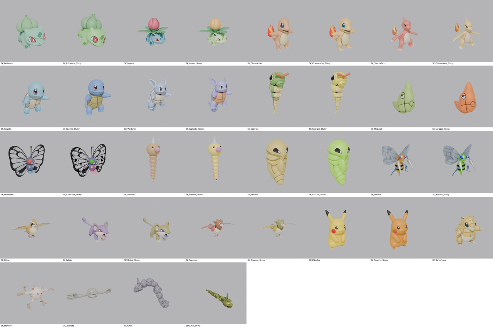

# Modèles 3D des Pokémon (V1)

Ticket : SCRUM-32. Modèles **provisoires** pris dans le dépôt public
[Pokemon-3D-api/assets](https://github.com/Pokemon-3D-api/assets) (projet privé, jamais publié : usage accepté).
On les remplacera au fil des sprints par des modèles plus réalistes.



## Ce qui est prêt

Les 20 Pokémon jouables en V1 (`bAvailableInV1` dans `DT_Species`) + 16 versions chromatiques
(absentes du dépôt : Roucool, Sabelette, Férosinge, Racaillou).

| Pokémon | Animations | Remarque |
|---|---|---|
| Bulbizarre | Idle, Walk, Run, Attack, Hit, Faint, JumpStart/Loop/End | le seul vraiment animé |
| Pikachu | Attack (Tonnerre) | |
| Dardargnan, Onix | Idle | |
| les 16 autres | aucune | squelette présent, animations à faire ou à récupérer |

- Taille réelle du Pokédex (`HeightM`) : Pikachu 40 cm, Bulbizarre 70 cm, Onix 8,8 m (longueur).
- Pieds à Z = 0, centré, en centimètres Unreal. Le Pokémon regarde +Y dans l'espace du mesh (comme le mannequin).
- Textures basse résolution (256 à 1024 px) : ce sont des modèles de style « jeu mobile ».
- Racaillou a les bras sur de longues tiges en pose de repos : c'est le modèle d'origine, à revoir.
- Onix chromatique n'a pas de squelette : il arrive en Static Mesh (`SM_Onix_Shiny`).

## Installer dans Unreal

1. L'éditeur peut rester ouvert.
2. Dézipper `Pokemon_Models_V1.zip` (dossier partagé du projet, `pokemon-modeles/`) dans
   `D:\Dev\pokemonnewage\Tools\Pokemon\Generated\` : on doit voir `Generated\models.json` et un dossier par Pokémon.
   Ce dossier est ignoré par Git.
3. **Outils > Exécuter un script Python** (Tools > Execute Python Script) → `Tools/Pokemon/import_pokemon_models.py`.
   Compter quelques minutes (36 modèles). Pour en importer seulement quelques-uns, mettre par exemple
   `ONLY = {"Pikachu"}` en haut du script.

Résultat, par espèce (nom de ligne de `DT_Species`) :

```
/Game/Pokemon/Models/<Espèce>/SK_<Espèce>          Skeletal Mesh
/Game/Pokemon/Models/<Espèce>/SKEL_<Espèce>        Squelette
/Game/Pokemon/Models/<Espèce>/PHYS_<Espèce>        Physics Asset
/Game/Pokemon/Models/<Espèce>/A_<Espèce>_Idle      animations (Idle, Walk, Attack...)
/Game/Pokemon/Models/<Espèce>/SK_<Espèce>_Shiny    version chromatique
/Game/Pokemon/Models/<Espèce>/Materials/           matériaux et textures
```

Le menu Pokédex (fiche du Pokémon) lit ces chemins tels quels : ne pas renommer les assets.

### Si quelque chose cloche

- **Matériau blanc ou gris** : ouvrir le matériau dans `Materials/`, brancher la texture `T_<Espèce>_1` sur Base Color.
- **Pokémon couché ou de dos** : dans le Skeletal Mesh, Détails > Transformation à l'import (Import Rotation), puis Réimporter.
- **Animation vide** : réimporter le FBX à la main (clic droit > Réimporter) en cochant Importer les animations.

## Refaire la conversion (optionnel)

Seulement pour ajouter d'autres Pokémon ou changer un réglage.

```
python Tools/Pokemon/download_pokemon_glb.py Tools/Pokemon/.glb          # V1 (ou --all pour les 151, ou des numéros)
blender --background --python Tools/Pokemon/convert_pokemon_glb.py -- Tools/Pokemon/.glb Tools/Pokemon/Generated
```

Blender installé normalement lit la compression Draco des .glb. Avec le module `pip install bpy` (cloud),
il faut d'abord la retirer : `node Tools/Pokemon/decompress_glb.mjs <entrée> <sortie>` (voir l'en-tête du fichier).

Ce que fait `convert_pokemon_glb.py` : taille du Pokédex, centimètres, textures WebP → PNG embarquées,
un seul mesh par Pokémon, retrait des morceaux parasites (sphère d'affichage des os, coque noire d'Onix,
lianes dépliées de Bulbizarre chromatique), texture branchée en direct sur Base Color, animations renommées.
