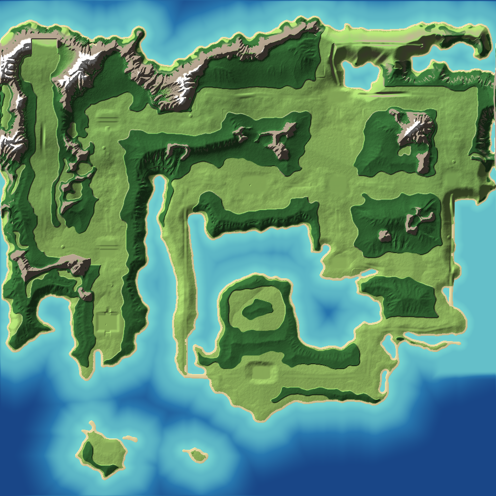

# Monde ouvert : tout Kanto en blockout (SCRUM-62)

Le jeu est un **monde ouvert** : une seule grande map, `L_Kanto`, au lieu d'une map par lieu. Unreal ne charge que les morceaux proches du joueur grâce au **World Partition**, l'outil prévu pour les grands mondes.

On travaille du grand vers le petit :

1. **Le terrain de tout Kanto** (ce guide) : le relief, les chemins, les villes et leurs bâtiments en blocs simples, les grottes et la lumière. On le traverse à pied pour voir où le relief gêne et corriger la heightmap avant d'aller plus loin.
2. **Le biome réaliste** : végétation, roches, eau, textures du sol.
3. **Les bâtiments en 3D**, puis le détail zone par zone (Bourg Palette SCRUM-23, Route 1 SCRUM-24, etc.), d'après les fiches du tableau Miro.
## Mise à jour : blockout de tout Kanto (octobre 2026)

Toutes les villes de Kanto ont maintenant leurs bâtiments en blocs (Centre Pokémon, Boutique, arène, Grand Magasin, Tour Sylphe, Tour Pokémon, Casino, Dojo, Manoir, Labo, Ligue, Centrale…), placés d'après le plan de *Rouge Feu / Vert Feuille*. Toutes les routes ont leur chemin de terre et leur couloir dans le relief, les postes de passage autour de Safrania sont posés, les entrées de grottes sont des porches sombres (Mont Sélénite, Tunnel Roche, Route Victoire, Grotte Taupiqueur, Caverne Azurée, Îles Écume). Les **hautes herbes** sont relevées automatiquement sur la carte FRLG (`make_frlg_mask.py` → `kanto_herbes.json`).

- **Plus d'arbres** dans le blockout : ils rallongeaient le chargement pour rien. Ils reviendront avec le biome.
- **Léger bruit au sol** dans la heightmap (environ ± 40 cm sur des bosses de 30 m, ± 20 cm sur des bosses de 9 m).
- Dans les villes, les positions de la carte FRLG sont resserrées (`TOWN_SCALE`, 2,5 m par case) pour que les bâtiments à taille réelle tiennent dans la ville ; sur les routes, une case fait toujours 6,5 m.

**Pour mettre à jour** (pas besoin de recompiler, pas de C++) :

1. Dans le terminal de VS Code : `git pull`.
2. Dans Unreal, mode **Paysage** > **Gérer** > **Importer** : choisir `Tools\Blockout\kanto_v1_heightmap.png`, mode d'importation **All**, puis **Importer**. Si tu as peint ton propre calque de bruit, sélectionne d'abord le calque de base dans **Calques d'édition** : ton calque reste par-dessus. Vérifier que **Échelle Z** vaut toujours 200 dans Détails.
3. Charger tout le terrain (World Partition Editor > sélectionner toute la carte > **Load Region From Selection**).
4. **Outils > Exécuter un script Python…** > `Tools\Blockout\blockout_kanto_v1.py`.
5. Parcourir la carte et noter les endroits où le relief gêne (une ville trop pentue, une route bouchée, un bâtiment dans une pente) : on corrige la heightmap avant le biome.

## Relief v2 : d'après le dessin (31 octobre 2026)

Le relief suit maintenant **le dessin de L'amie** (`Tools/Blockout/reference/dessin_kanto.png`, retouche Photoshop de la vue du dessus). `make_dessin_mask.py` y lit quatre zones (mer, plaine, forêt, montagne) et les range dans `kanto_dessin.png`, que `make_heightmap.py` utilise pour tout le reste :

- **Mer** : 0 à 2 m de fond sur environ 150 m (eau claire), puis 15 m au large. Plages en pente douce, sans falaise ni crique. 1,5 m au plus le long de la Route 12 (pour un pont).
- **Plaines** (routes et villes) : au niveau des routes, collines douces. Les villes sont aplanies avec un fondu de 70 m, sans marche. Bourg Palette est au fond d'une cuvette de 300 × 250 m (talus de 6 m, ouverte au nord et au sud).
- **Forêts** : un talus de 5 à 18 m au bord des plaines, que les arbres cacheront et qui empêche de couper entre deux routes, puis des collines boisées.
- **Montagnes** (zones grises du dessin, tampons de rochers compris) : crêtes et pics fins jusqu'à environ 450 m.
- **Altitudes** : de 4 m (Carmin sur Mer) à 210 m (Plateau Indigo) ; le cap de la Route 25 est à 195 m. Huit petits belvédères de 5 m au bord des routes.
- `kanto_forets.png` (1009 × 1009, même sens que la heightmap) : masque des forêts pour le PCG des arbres.

**Pour changer la forme** : retoucher le dessin, le remplacer dans `reference/`, puis `python Tools/Blockout/make_dessin_mask.py` et `python Tools/Blockout/make_heightmap.py` (environ 11 minutes ; `--test <dossier>` fait un essai en 40 secondes). Les retouches fines se font ensuite au **sculpt dans Unreal** : les faire dans un **calque d'édition à part** (Calques d'édition > clic droit > Créer un calque), sinon un prochain import de heightmap les effacerait.

## Ce qui est réaliste dès maintenant

- **Les tailles** : un personnage fait 1,80 m, une maison 9 × 11 m et 7 m de haut, une arène 26 × 30 m, la Tour Sylphe 36 × 36 m et 60 m de haut. Les bâtiments ont leur vraie taille, ce qui laisse la place à des intérieurs sans chargement plus tard.
- **La forme de Kanto** : le terrain est décalqué sur la carte complète de *Rouge Feu / Vert Feuille* (routes, villes, mer, lacs, extraits de l'image par `make_frlg_mask.py`), la côte extérieure suit celle de *Let's Go*. Tout Kanto est là, entouré de mer : environ 5,3 × 5,2 km sur un terrain de 6 km de côté. Toutes les villes, routes et entrées de grottes sont posées.
- **Les routes sont obligatoires** : hors des routes, le relief bloque (falaise de 25 à 40 m au bord, puis des flancs raides et des chaînes de montagnes en crêtes). On ne coupe pas à travers les montagnes comme dans *Breath of the Wild* : on suit les vallées, les cols et les plateaux, comme dans les jeux.
- **Des villes en hauteur** : chaque ville a son altitude, les routes montent et descendent entre elles. Bourg Palette 22 m, Jadielle 48 m, Argenta sur un plateau à 140 m, le Plateau Indigo à 330 m, Lavanville à 115 m, Carmin sur Mer et Parmanie au bord de l'eau. Les villes de la V1 sont en **terrasses** (2 ou 3 niveaux reliés par des rampes).
- **Le relief** : massifs en crêtes (Route Victoire, Mont Sélénite, Tunnel Roche…, jusqu'à 500 m), côtes variées (plages, falaises, caps, baies), lacs en hauteur, puis une **érosion par la pluie** qui creuse vallées et ravines. Pas de mer à Bourg Palette : la côte la plus proche est à plus de 300 m au sud.
- **La lumière** : ciel physique, soleil d'après-midi, nuages volumétriques et brume légère.
- **Le sol** : herbe sur le plat, roche sur les pentes raides, sable au bord de la mer. Un **léger bruit** (quelques dizaines de centimètres) casse le côté trop lisse partout, sauf dans les villes et dans l'eau.

Les couleurs restent des couleurs de blockout : les vrais modèles et textures viendront après.

## Le plan

Vu de dessus, nord en haut. Environ 6 km de côté, la V1 est la vallée à l'ouest (Bourg Palette en bas, Argenta en haut).



La heightmap elle-même en gris (noir = fond de la mer, blanc = sommets) : `Tools/Blockout/kanto_v1_heightmap_apercu.png`.

| Lieu | Taille | Distance depuis Bourg Palette |
|---|---|---|
| Bourg Palette | 78 × 74 m, plan de Rouge Feu / Vert Feuille | départ |
| Route 1 | environ 750 m de long | |
| Jadielle | 185 × 175 m | environ 750 m |
| Route 22 (vers l'ouest) | environ 750 m, finit au Poste de la Ligue | |
| Route 2 (sud) puis Forêt de Jade (415 × 370 m) puis Route 2 (nord) | | |
| Argenta | 175 × 150 m | environ 1,7 km |

Bourg Palette → Argenta : environ **12 à 15 minutes en marchant, 6 à 7 minutes en courant**. Les villes ont leur taille réelle ; ce sont les routes qui donnent la durée du trajet. Pour allonger ou raccourcir, on change `CELL` (mètres par case de la carte FRLG) dans le plan.

### Bourg Palette

Le plan suit celui de Rouge Feu / Vert Feuille : la maison du joueur (toit rouge) en haut à gauche, celle du rival (toit bleu) en haut à droite, le labo du Prof. Chen en bas à droite, un parterre de fleurs avec sa barrière à gauche, l'étang en bas à gauche, une barrière et un panneau en bas, le tout entouré d'un mur d'arbres avec la sortie de la Route 1 au nord.

Le plan est écrit dans `Tools/Blockout/kanto_v1_layout.py` (villes et cols repérés en cases de la carte FRLG avec leur altitude, massifs, terrasses, bâtiments, chemins, hautes herbes). Le décalque de la carte FRLG est dans `kanto_frlg.bin`, la côte de *Let's Go* dans `kanto_terres.bin`. Pour changer quelque chose, on modifie ce fichier, puis on relance le script.

## Pas à pas (30 minutes)

### 1. Récupérer le travail

1. **Fermer Unreal.**
2. Dans le terminal de VS Code :
   ```
   git checkout claude/project-thread-5j8wl2
   git pull
   ```
3. **Ctrl+Maj+B** puis **PokemonNewAgeEditor Win64 Development Build**. Attendre « Succeeded ».
4. Ouvrir `PokemonNewAge.uproject`.

### 2. Créer la map du monde ouvert

1. **Fichier > Nouveau niveau**, choisir **Empty Open World** (« Monde ouvert vide »), puis **Créer**. Ce modèle active le World Partition.
2. **Fichier > Enregistrer le niveau sous** : créer le dossier `Kanto` dans `Content/World`, nommer la map **`L_Kanto`**.

### 3. Importer le relief

1. Passer en **mode Paysage** (Maj+2, ou le menu des modes en haut à gauche > **Paysage**).
2. Onglet **Gérer** > **Nouveau** > cocher **Importer depuis un fichier**.
3. **Fichier de heightmap** : `D:\Dev\pokemonnewage\Tools\Blockout\kanto_v1_heightmap.png`.
4. Régler :
   - **Emplacement** : 0, 0, 0 ;
   - **Échelle** : **150, 150, 200**. C'est important : 150 fait 1,5 m entre deux points, donc un terrain de 6 km (4033 points de côté), et 200 permet des montagnes jusqu'à 500 m ;
   - laisser la taille des sections proposée par Unreal (elle se règle d'après le fichier).
5. Cliquer sur **Importer**. Le relief apparaît (gris quadrillé pour l'instant, le script lui donne une couleur). L'import peut prendre une minute.
6. Revenir en **mode Sélection** (Maj+1).
7. **Charger le terrain** : avec le World Partition, il est découpé en morceaux qui ne sont pas chargés tout de suite (l'Outliner affiche par exemple « 263 acteurs (7 chargés) » et la vue reste noire). Ouvrir **Fenêtre > World Partition > World Partition Editor**, sélectionner toute la carte par un clic-glisser, puis **clic droit > Load Region From Selection**.
8. **Enregistrer** (Ctrl+S). La vue reste sombre tant que le script n'a pas posé la lumière ; **Alt+3** (mode non éclairé) permet de voir le relief en attendant, **Alt+4** revient au mode normal.

### 4. Lancer le script

1. **Outils > Exécuter un script Python…**
2. Choisir `D:\Dev\pokemonnewage\Tools\Blockout\blockout_kanto_v1.py`.
3. Patienter quelques minutes : une barre de progression s'affiche. Le script pose environ 5 600 objets pour tout Kanto (sans arbres, pour garder un chargement rapide), rangés dans le dossier **Kanto_Blockout** de l'Outliner, puis enregistre tout.

Le script efface et repose tout à chaque lancement : on peut le relancer après une modification du plan.

### 5. Tester

1. **Play**. On démarre à Bourg Palette, entre les deux maisons, face au nord.
2. Vérifier :
   - aller jusqu'à Argenta à pied, puis en courant : est-ce trop long, trop court ?
   - les maisons et l'arène ont une taille crédible à côté du personnage ;
   - on ne peut pas sortir des routes : les falaises et les pentes bloquent. Des murs invisibles restent seulement au bord de l'eau ;
   - on traverse bien les postes (Forêt de Jade, Ligue, les quatre postes autour de Safrania) ;
   - la lumière et le ciel rendent bien.
3. Noter ce qui ne va pas et me l'envoyer (une capture aide beaucoup).

### 6. Enregistrer dans Git

Avec le World Partition, chaque objet est un petit fichier dans `Content/__ExternalActors__` : c'est normal qu'il y en ait beaucoup.

```
git status
git add Content
git commit -m "SCRUM-62 Ajouter la map L_Kanto avec le relief et le blockout de la V1"
git push
```

`git add Content` prend aussi `IMC_Default` (le clavier en ZQSD), qui attendait d'être enregistré.

L'ancienne map `L_PalletTown` ne sert plus : on peut supprimer le dossier `Content/World/PalletTown` dans Unreal (clic droit > Supprimer) avant le commit.

## Si ça ne marche pas

- **Pas de modèle « Empty Open World »** : créer un niveau **Basic**, l'enregistrer en `L_Kanto`, puis **Outils > Convertir le niveau** et cocher le World Partition.
- **« Pas de Landscape »** dans le journal : l'étape 3 n'a pas été faite, ou le Landscape est dans une autre map.
- **« Échelle du Landscape inattendue »** : l'échelle de l'étape 3 n'était pas 150, 150, 200. Supprimer le Landscape et le réimporter.
- **Le sol reste gris quadrillé** : sélectionner le Landscape, panneau Détails, **Landscape Material** : choisir `M_Kanto_Sol` (dans `Content/World/Kanto/Blockout`).
- **Un nom de lieu s'affiche à l'envers** : chaque panneau a deux faces, une seule est à l'endroit selon le côté d'où on regarde.
- **Le script ne fait rien** : **Fenêtre > Journal de sortie**, chercher les lignes `LogPython`, et m'envoyer le message.

## Refaire le relief

Le relief vient de `Tools/Blockout/make_heightmap.py`, qui lit le même plan. Unreal relit ensuite le PNG produit pour poser les objets pile sur le sol. Après une modification du plan, le relancer (`pip install numpy numba` la première fois, puis `python Tools/Blockout/make_heightmap.py`, environ 11 minutes), puis réimporter le PNG dans le Landscape (mode Paysage > Gérer > Importer) et relancer le script de blockout.

**Si la taille du terrain change** (par exemple de 2017 à 4033 points quand on a agrandi la carte), l'outil Importer refuse le fichier : supprimer le Landscape dans l'Outliner, puis refaire l'étape 3 (nouveau Landscape, échelle 150, 150, 200) et l'étape 7 (charger tout le terrain).

**Passage à la version FRLG (octobre 2026)** : l'échelle en hauteur passe de 100 à 200. Il faut donc **supprimer l'ancien Landscape** et refaire l'étape 3 avec 150, 150, 200, puis l'étape 7 et le script.

Le décalque de la carte FRLG se refait avec `python Tools/Blockout/make_frlg_mask.py carte_frlg.png` (`pip install numpy pillow`), à partir de l'image complète de Kanto (tuiles assemblées sur fond en damier). Il produit `kanto_frlg.bin` et un aperçu `kanto_frlg_apercu.png`.

## Points de téléportation de test

Pour tester la map sans tout traverser à pied : poser des **TeleportPoint** (Placer des acteurs, chercher « Teleport Point »), donner un nom dans **Point Name** (Argenta, Route3...) et tourner la flèche bleue dans le sens où le joueur doit regarder. Ils sont toujours chargés (pas de streaming World Partition).

En jeu, console (touche ²) :
- `Teleports` : liste numérotée des points ;
- `Teleport Argenta` (ou `Teleport arg`, ou `Teleport 2`) : y aller.

Astuces de test : `slomo 4` accélère tout le jeu, `ghost` pour voler à travers le décor, `walk` pour revenir à la marche.
